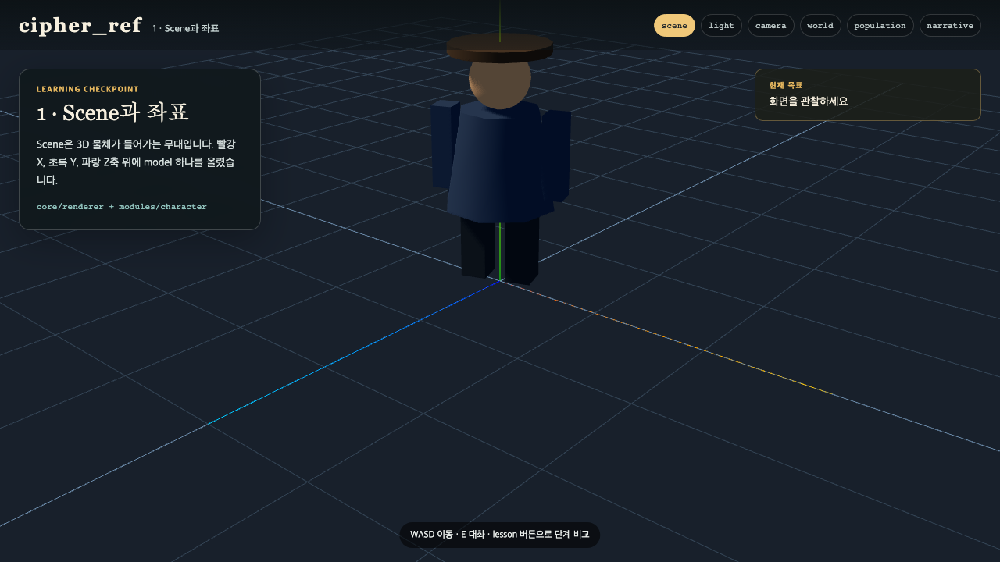
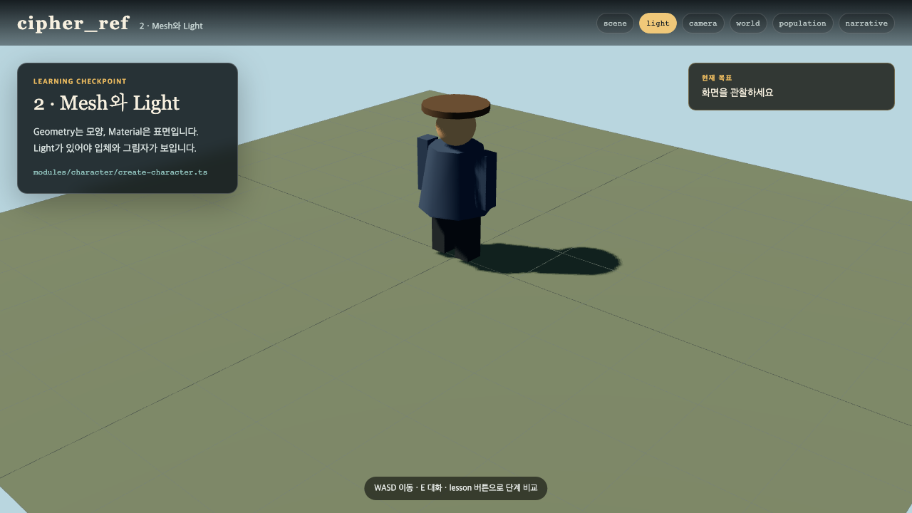
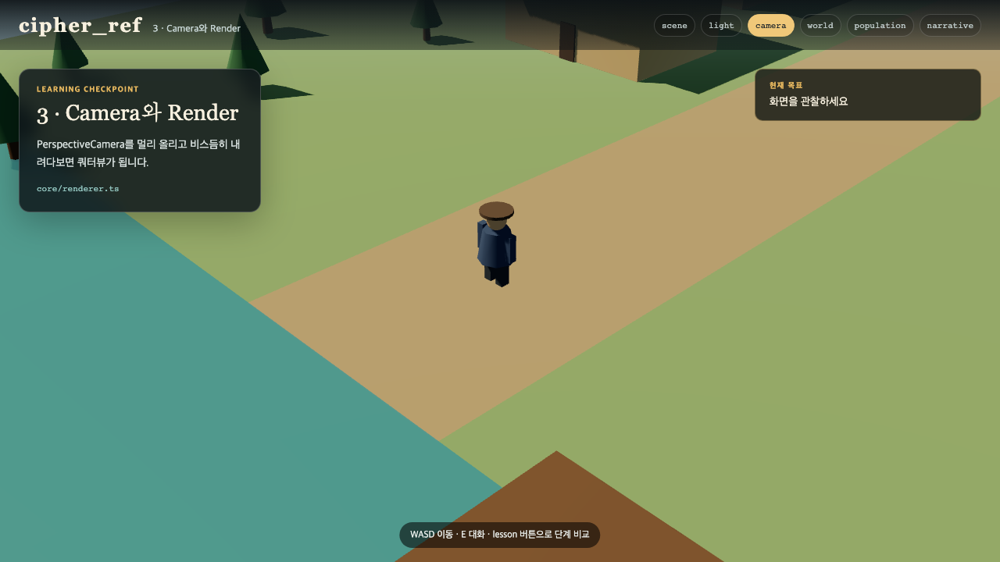

# 01. 3D 게임의 기본 세 쪽

처음부터 WebGPU나 shader를 설명하면 화면에 캐릭터 하나 띄우기도 전에 지칩니다. 여기서는 `cipher_ref`를 이해하는 데 필요한 다섯 단어만 먼저 익힙니다. Scene, Geometry, Material, Light, Camera입니다.

## 첫째 쪽 · Scene과 좌표

3D 게임의 공간에는 가로 X, 높이 Y, 깊이 Z가 있습니다. `Scene`은 이 좌표 위에 물체를 올려놓는 무대입니다. 빨간 선이 X, 초록 선이 Y, 파란 선이 Z입니다.

```ts
const scene = new THREE.Scene();
const character = createCharacter( heroDef );
scene.add( character.root );
```

`character.root.position.set(2, 0, -3)`이라고 쓰면 캐릭터가 오른쪽으로 2, 화면 안쪽으로 3만큼 갑니다. Y를 1로 바꾸면 땅에서 한 칸 떠오릅니다.



이 화면에서는 model을 외부 파일로 불러오지 않습니다. 원기둥 몸통, 구 머리, 상자 팔과 다리를 묶어 캐릭터 하나를 만들었습니다. GLB model도 결국 Scene에 들어가는 하나의 `Object3D`라는 점은 같습니다.

체크포인트: `?lesson=scene`에서 축과 캐릭터가 보이고 캐릭터가 천천히 회전합니다.

## 둘째 쪽 · Geometry, Material, Light

`Geometry`는 모양이고 `Material`은 표면입니다. 같은 상자 모양에도 나무색 재질을 입히면 상자가 되고 회색 금속 재질을 입히면 철판이 됩니다.

```ts
const geometry = new THREE.BoxGeometry(1, 1, 1);
const material = new THREE.MeshStandardMaterial({ color: 0x8b5c4a });
const mesh = new THREE.Mesh(geometry, material);
```

Geometry와 Material을 합친 것이 `Mesh`입니다. 하지만 Light가 없으면 표면의 밝고 어두운 면과 그림자가 보이지 않습니다. sample은 해 역할의 `DirectionalLight`와 그늘을 조금 밝히는 `AmbientLight`를 함께 씁니다.



체크포인트: `?lesson=light`에서 몸의 면마다 밝기가 다르고 땅에 그림자가 생깁니다.

## 셋째 쪽 · Camera와 render loop

Scene 안에 물체가 있어도 Camera가 보지 않으면 화면에 나오지 않습니다. `cipher_ref`는 시야각 32도의 PerspectiveCamera를 위와 옆으로 15미터 떨어뜨려 쿼터뷰를 만듭니다.

```ts
camera.position.set(15, 13, 15);
camera.lookAt(player.position);
renderer.render(scene, camera);
```

한 번만 그리면 사진입니다. 게임은 위치를 바꾸고 다시 그리는 일을 매 frame 반복합니다.

```ts
function frame() {
  updatePlayer();
  updateNpcs();
  renderer.render(scene, camera);
  requestAnimationFrame(frame);
}
```



여기까지 이해했다면 3D engine의 모든 기능을 아는 것은 아닙니다. 하지만 model이 왜 화면에 보이고, 이동할 때 왜 다시 그려야 하며, Camera 숫자를 바꾸면 구도가 왜 달라지는지는 이해한 것입니다. 이제 reference repo를 내려받아 실제 module을 바꿀 준비가 됐습니다.
