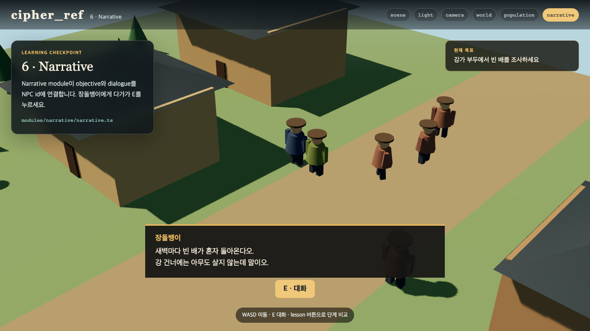

# 02. GitHub에서 내려받아 첫 실행

이제 공개 저장소를 내 컴퓨터로 가져옵니다. 이 장에서 직접 만드는 것은 없습니다. 대신 앞으로 바꿀 reference game이 같은 상태로 실행되는지 확인합니다.

## 준비

Node.js 22.18 이상과 Git이 필요합니다.

```bash
node -v
git --version
```

Node.js가 없다면 nodejs.org에서 LTS를 설치합니다. 버전이 낮으면 TypeScript 파일을 test에서 바로 읽지 못할 수 있습니다.

## clone과 install

```bash
git clone https://github.com/gykim80/cipher_ref.git
cd cipher_ref
npm install
npm run dev
```

터미널에 아래처럼 주소가 나옵니다.

```text
VITE ready
Local: http://127.0.0.1:4173/
```

Chrome에서 주소를 열면 강가와 작은 마을, 파란 옷의 주인공, 움직이는 NPC가 보입니다.



## 여섯 단계 화면

같은 repository 안에서 제작 단계를 비교할 수 있습니다.

```text
/?lesson=scene
/?lesson=light
/?lesson=camera
/?lesson=world
/?lesson=population
/?lesson=narrative
```

앞의 세 화면은 3D 기본을 보여 주고, 뒤의 세 화면은 module이 쌓이는 과정을 보여 줍니다. 완성 화면만 보는 것보다 어느 단계에서 무엇이 추가됐는지 쉽게 찾을 수 있습니다.

## 첫 검사

```bash
npm run verify
```

test와 production build가 모두 성공해야 다음 장으로 넘어갑니다. 오류가 나면 먼저 `node -v`, `npm install`을 확인합니다.

체크포인트: WASD로 주인공이 화면 기준 방향으로 걷고, 장돌뱅이 가까이에서 E를 누르면 대화가 뜹니다.
