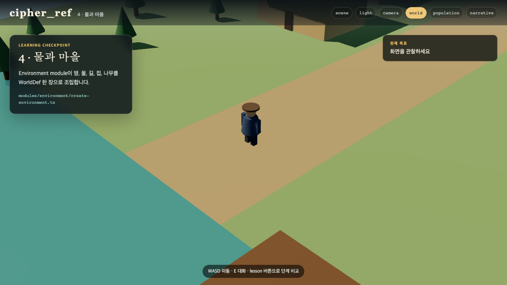

# 04. 물·지형·마을 바꾸기

배경은 장식만이 아닙니다. 길의 폭은 이동을 바꾸고, 건물 위치는 NPC가 설 곳을 바꾸고, 물가의 방향은 Camera 구도를 바꿉니다. 이 정보는 `world` 한 객체에 모여 있습니다.



## 물 색과 폭

`src/content/sample-content.ts`에서 다음 부분을 찾습니다.

```ts
water: {
  side: 'south',
  width: 11,
  color: 0x3f8795,
},
```

`width`를 16으로 바꾸면 강이 넓어집니다. `color`는 16진수 색입니다. `0x315f78`은 짙은 푸른색, `0x567f62`는 녹색이 섞인 물입니다.

## 집 하나 추가

```ts
{
  id: 'tea_house',
  at: [4, -2],
  size: [5, 3, 4],
  color: 0xd0b985,
},
```

`at`은 `[x, z]`, `size`는 `[가로, 높이, 깊이]`입니다. 같은 위치에 집을 겹치면 화면에서는 둘이 파고듭니다. Population module은 이 상자를 장애물로 보고 NPC를 그 안에 놓지 않습니다.

## WorldDef가 화면이 되는 과정

```ts
const environment = createEnvironment(world);
scene.add(environment.root);
```

Environment module은 ground plane, water plane, road, building, tree, dock을 Group 하나로 묶어 돌려줍니다. `main.ts`는 내부가 어떻게 생겼는지 모르고 Group만 Scene에 넣습니다.

## 직접 해 보기

1. 물 폭을 14로 바꿉니다.
2. 집 색 하나를 붉은 흙색으로 바꿉니다.
3. 집 하나를 추가합니다.
4. `npm run dev` 화면에서 집이 겹치지 않는지 봅니다.
5. `npm run verify`를 실행합니다.

체크포인트: `?lesson=world`에서 물, 길, 새 집이 보이고 주인공은 WASD로 그 사이를 걸을 수 있습니다.
