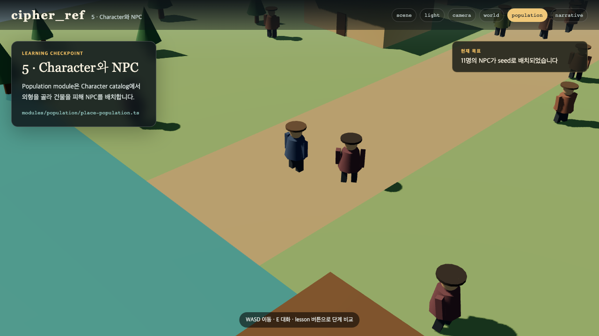

# 05. 캐릭터와 배경 NPC 배치

캐릭터와 NPC 배치는 같은 일이 아닙니다. Character module은 생김새를 만들고, Population module은 누구를 어디에 몇 명 놓을지 정합니다. 이 둘을 분리하면 같은 포졸 model을 문지기, 순찰대, 이야기 인물로 다시 쓸 수 있습니다.



## Character catalog

```ts
{
  id: 'merchant',
  name: '장돌뱅이',
  color: 0x6e7a3e,
  height: 1.72,
  role: 'civilian',
}
```

현재 sample은 원기둥과 상자로 인물을 만듭니다. 나중에 GLB model을 붙여도 `id`, `height`, `role` 계약은 그대로 유지합니다. 주인공도 catalog에 있지만 Population group에는 넣지 않습니다.

## 배경 NPC group

```ts
{
  id: 'villagers',
  character: 'villager',
  count: 7,
  area: [-18, -21, 18, 4],
  behavior: 'wander',
},
```

Population module은 `seed`와 group id로 위치를 만듭니다. 같은 seed에서는 새로 실행해도 같은 곳에 섭니다. 건물 상자 안은 피하고 NPC 사이에는 최소 간격을 둡니다.

행동은 세 가지로 시작합니다.

- `idle`: 제자리에서 기다립니다.
- `wander`: 집 근처를 천천히 걷습니다.
- `patrol`: 더 넓은 반경을 순찰합니다.

## 직접 해 보기

1. `villagers.count`를 12로 바꿉니다.
2. `guard` 캐릭터의 옷 색과 키를 바꿉니다.
3. `guards.behavior`를 `idle`로 바꿔 움직임 차이를 봅니다.
4. group의 `area`를 좁혀 공간 부족 오류가 나는지 확인합니다.

```bash
npm test
```

test는 같은 seed의 배치가 같은지, NPC가 집 안에 생기지 않는지, 없는 character id를 참조하지 않는지 검사합니다.

체크포인트: `?lesson=population`에서 11명의 NPC가 보이고 주민과 경비의 행동 반경이 다릅니다.
