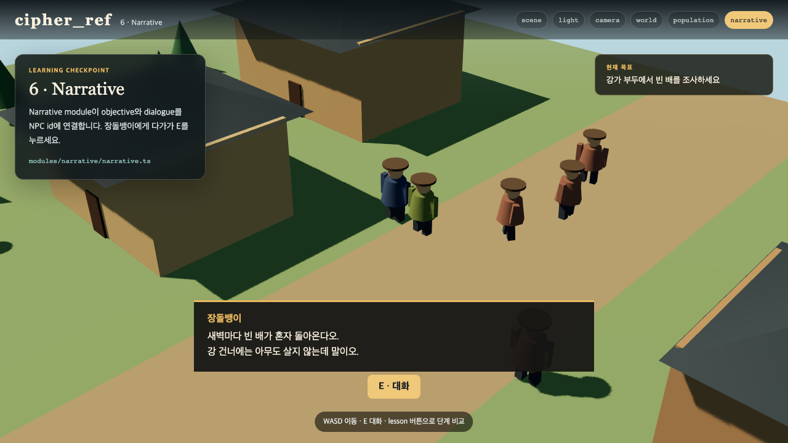

# 06. 시나리오를 objective와 dialogue로 만들기

시나리오 원문을 그대로 게임에 넣으면 플레이어가 무엇을 해야 하는지 알 수 없습니다. Narrative module은 이야기를 작은 beat로 나눕니다. beat 하나에는 목표, 시작 조건, 선택적인 대화가 있습니다.



## 한 줄 시나리오

먼저 한 줄로 씁니다.

> 새벽마다 사람이 없는 빈 배가 돌아온다는 소문을 들은 여행자가 강가를 조사한다.

이 문장을 플레이 순서로 나눕니다.

1. 장터의 장돌뱅이에게 소문을 듣는다.
2. 강가 부두로 간다.
3. 빈 배를 조사한다.

## Beat로 옮기기

```ts
{
  id: 'ask',
  objective: '장터의 장돌뱅이에게 말을 거세요 · E',
  trigger: { kind: 'talk', npc: 'merchant_1' },
  dialogue: 'rumor',
}
```

`trigger`는 이 beat가 언제 끝나는지를 정합니다. `merchant_1`은 Population module이 `merchant` group의 첫 번째 NPC에 붙인 id입니다.

## 대사는 별도 데이터로

```ts
{
  id: 'rumor',
  speaker: '장돌뱅이',
  lines: [
    '새벽마다 빈 배가 혼자 돌아온다오.',
    '강 건너에는 아무도 살지 않는데 말이오.',
  ],
}
```

대사를 beat 안에 길게 넣지 않으면 같은 대화를 다른 trigger에서도 재사용하고 번역 파일로 옮기기 쉽습니다.

## 직접 해 보기

1. 소문의 내용을 자기 세계관에 맞게 바꿉니다.
2. objective를 그 소문과 이어지게 바꿉니다.
3. `merchant_1`을 존재하지 않는 id로 바꾸고 test가 실패해야 할 이유를 생각합니다.
4. 원래 id로 되돌리고 브라우저에서 장돌뱅이 가까이 가 E를 누릅니다.

체크포인트: 대화가 뜬 뒤 오른쪽 위 목표가 다음 행동으로 바뀝니다.
